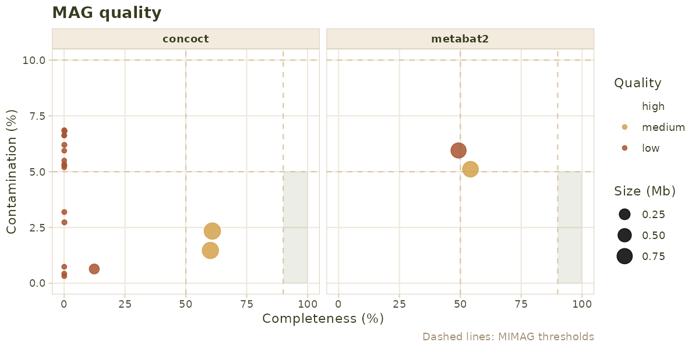
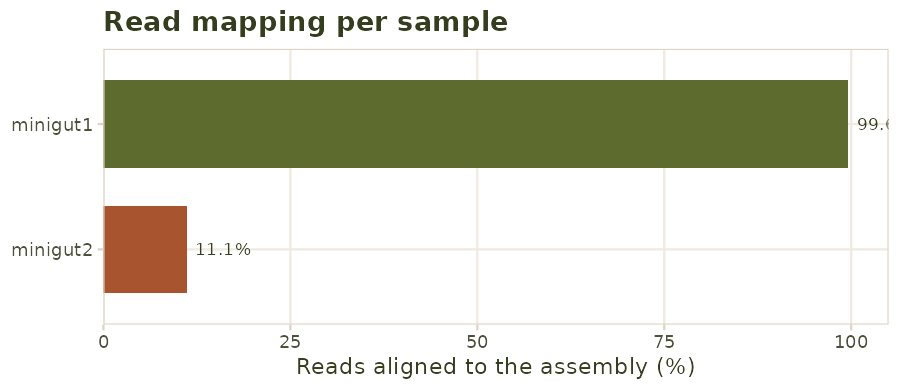
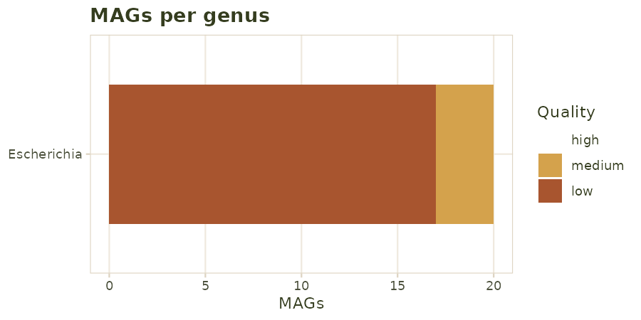
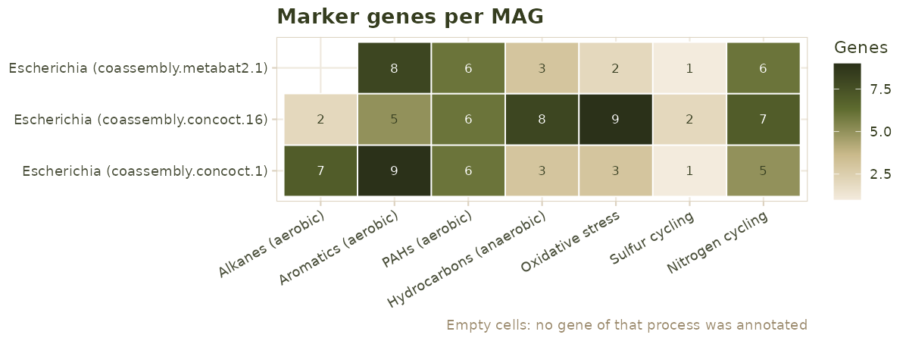
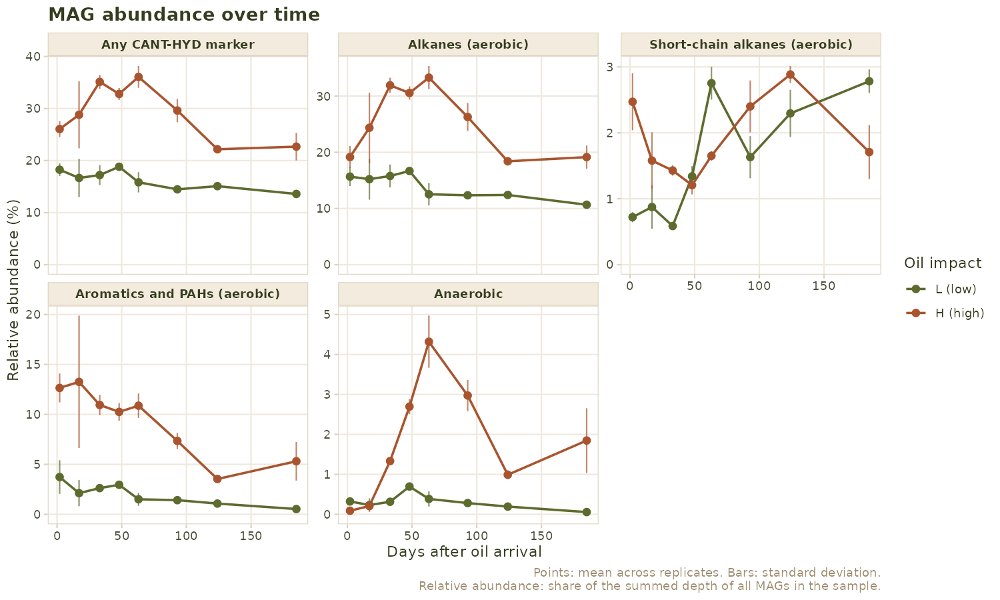
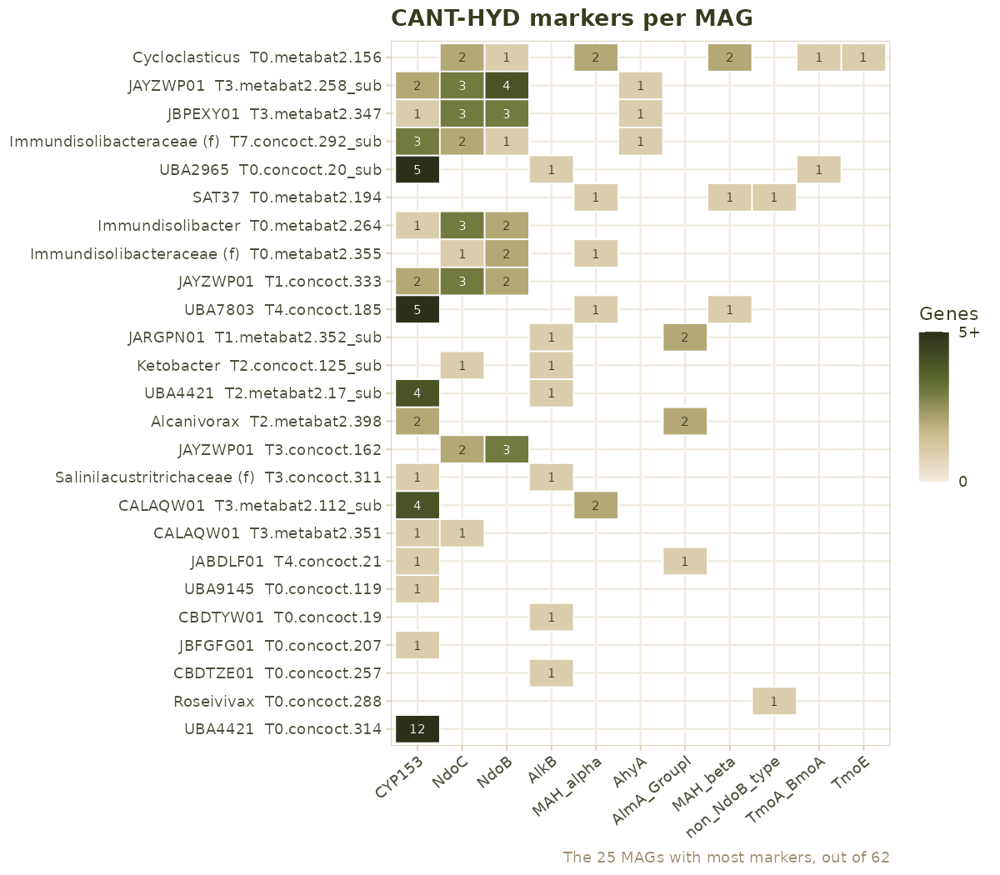

# magreport

<!-- badges: start -->
[](https://github.com/AntonioPuriel/magreport/actions/workflows/R-CMD-check.yaml)
<!-- badges: end -->

R package to explore and report MAG recovery results from
[mag-pipeline](https://github.com/AntonioPuriel/mag-pipeline).

The pipeline writes plain tables; `magreport` reads them into tidy data frames
with the right types, so you can go straight to analysis and figures.


## Installation

```r
# install.packages("remotes")
remotes::install_github("AntonioPuriel/magreport")
```

## Usage

```r
library(magreport)

results <- "path/to/mag-pipeline/results"

mags    <- read_mag_quality(file.path(results, "05_quality/mag_quality.tsv"))
bins    <- read_bin_summary(file.path(results, "04_binning/bin_summary.tsv"))
mapping <- read_mapping_summary(file.path(results, "03_mapping/mapping_summary.tsv"))
depth   <- read_depth(file.path(results, "03_mapping/coassembly.depth.txt"))

count_quality(mags, by = "binner")

# Everything at once, plus an HTML report
run <- read_pipeline(results)
mag_report(results, "mag_report.html")

plot_mag_quality(mags, facet_by = "binner")
plot_mapping_rates(mapping)
plot_taxonomy(mags, rank = "phylum", fill_by = "quality")
```

The plotting functions need ggplot2, which is a suggested dependency:
`install.packages("ggplot2")`.

Every function ships an example that runs on the output included in the package,
so you can try it without your own data:

```r
path <- system.file("extdata", "example_run", "mag_quality.tsv", package = "magreport")
head(read_mag_quality(path))
```

## Functions

| Function | Reads |
|----------|-------|
| `read_mag_quality()` | `05_quality/mag_quality.tsv` (quality and taxonomy per MAG) |
| `read_bin_summary()` | `04_binning/bin_summary.tsv` (size, N50 and GC per bin) |
| `read_mapping_summary()` | `03_mapping/mapping_summary.tsv` (alignment rate per sample) |
| `read_depth()` | `03_mapping/*.depth.txt` (contig coverage per sample) |
| `read_ko_table()` | `07_function/ko_per_mag.tsv` (KEGG orthologues per MAG) |
| `read_annotation_stats()` | `07_function/annotation_stats.tsv` (annotated fraction per MAG) |
| `read_mimag_quality()` | `05_quality/mimag_quality.tsv` (MIMAG category, rRNA and tRNA genes, taxonomy) |
| `read_hydrocarbon_genes()` | `07_function/hydrocarbon_per_mag.tsv` (CANT-HYD and HADEG markers per MAG) |
| `read_mag_abundance()` | `04_binning/mag_abundance.tsv` (depth and relative abundance per MAG and sample) |
| `parse_sample_names()` | Splits sample names such as `T3-BB-O-2` into design columns |
| `count_quality()` | Counts MAGs per MIMAG quality category |
| `read_pipeline()` | Finds and reads every table of a run in one call |
| `mag_report()` | Renders a full HTML report of a run |

## Plots

All figures below come from the example output shipped with the package, and are
regenerated with `data-raw/make_readme_figures.R`.

### `plot_mag_quality()`

Completeness against contamination, with the MIMAG thresholds and the
high-quality corner shaded. Point size is the size of the MAG.



### `plot_mapping_rates()`

Share of reads of each sample that map back to the assembly. Samples below the
threshold are highlighted, since their coverage is less trustworthy.



### `plot_taxonomy()`

MAGs per taxon at any rank. Unclassified MAGs are kept as their own group
instead of being dropped.



## Marker genes

`plot_pathway_presence()` crosses the KEGG orthologues of each MAG with a set of
marker genes and answers the question that follows MAG recovery in a polluted
site: which genomes can do what. The package ships `hydrocarbon_kos()`, a curated
set covering aerobic alkane, aromatic and PAH degradation, anaerobic degradation
through fumarate addition and the benzoyl-CoA route, oxidative stress, and sulfur
and nitrogen cycling as environmental context. Any data frame with `pathway` and
`ko` columns can be used instead.

### `plot_pathway_presence()`



## Real data: Marine Honour oil spill

The package ships real output of
[mag-pipeline](https://github.com/AntonioPuriel/mag-pipeline) v1.9.1 on the
public study of the 2024 Marine Honour oil spill in Singapore
([PRJNA1263040](https://www.ncbi.nlm.nih.gov/bioproject/PRJNA1263040)):
48 intertidal sediment samples from 8 sampling times (2 to 185 days after the oil
arrived), a low-impact (C) and a high-impact (O) site, 3 replicates each. The
eight co-assemblies gave 1,161 refined bins. After removing 157 chimeric bins
(GUNC) and 184 of low quality, galah grouped the remaining 820 into
**281 species-level MAGs**: 6 of high and 275 of medium MIMAG quality, 280
bacterial and 1 archaeal. 244 of them have no species representative in GTDB.

`inst/extdata/marine_honour` holds 74 of those MAGs (the 62 with a CANT-HYD
marker, the high-quality ones and the strongest responders) and the abundance of
all 281 in the 48 samples.

### `plot_abundance_timeline()`

Follows groups of MAGs over time. Here, the MAGs grouped by the hydrocarbon
degradation markers that CANT-HYD found in them (`hydrocarbon_groups()`):

```r
dir <- system.file("extdata", "marine_honour", package = "magreport")
abundance <- read_mag_abundance(file.path(dir, "mag_abundance.tsv.gz"))
genes     <- read_hydrocarbon_genes(file.path(dir, "hydrocarbon_per_mag.tsv"))

samples <- parse_sample_names(abundance$sample,
                              into = c("time", "site", "condition", "replicate"))
samples$day <- c(T0 = 2, T1 = 17, T2 = 33, T3 = 48,
                 T4 = 63, T5 = 93, T6 = 124, T7 = 185)[samples$time]

plot_abundance_timeline(abundance, samples,
                        groups = hydrocarbon_groups(genes),
                        time = "day", condition = "condition",
                        time_label = "Days after oil arrival")
```



### `plot_hydrocarbon_genes()`

Which markers each MAG carries, labelled with its GTDB taxonomy. MAGs without a
genus name take the closest named rank, marked with its initial.



## Report

`mag_report()` takes a results directory and writes a self-contained HTML report
with the mapping, assembly, binning, MAG quality and taxonomy sections. Sections
without data are skipped with a note, so a run without GTDB-Tk or CheckM2 still
produces a valid report.

## Documentation

Full function reference: <https://antoniopuriel.github.io/magreport/>

## License

MIT
